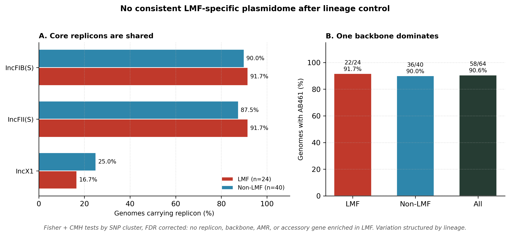

# Lineage-aware comparative genomics shows no consistent reservoir-specific plasmidome in low-moisture food associated Salmonella Enteritidis

This repository contains the code, curated metadata, processed tables, figures, and manuscript-linked outputs for the study above.

## Citation

Tenzin K, Balyatanda SB, Prakash SDP, Siliveru K, Platt TG (2026). Lineage-aware comparative genomics shows no consistent reservoir-specific plasmidome in low-moisture food associated Salmonella Enteritidis. Food Research International 242: 120003. https://doi.org/10.1016/j.foodres.2026.120003

Authors are at Kansas State University: Department of Grain Science and Industry, and Division of Biology. The first three authors contributed equally.

If you reuse code or tables from this repo, please cite the paper above.

## Question

Do Salmonella Enteritidis isolates from low-moisture foods (LMFs) such as nuts, spices, grains, and dried snacks carry a distinct plasmidome compared with non-LMF isolates, mostly poultry and egg associated and production-environment isolates?

Plasmids can carry stress tolerance, biocide tolerance, virulence, and antimicrobial resistance genes, so a distinct LMF plasmidome would matter for persistence and food safety. The challenge is that plasmid content is strongly structured by lineage. A pooled comparison that ignores lineage can mistake lineage differences for reservoir differences.

This study therefore compares LMF and non-LMF isolates within shared lineages.

## Main finding

After controlling for lineage using SNP cluster stratification, there was no consistent reservoir-specific enrichment of plasmid replicons, plasmid backbones, acquired AMR determinants, or accessory gene functions in LMF-associated isolates. Genomic variation was structured primarily by lineage rather than reservoir origin.

In plain terms: LMF isolates did not share a common plasmid signature that non-LMF isolates lacked. Differences that did appear were lineage-specific or isolate-specific, not reservoir-wide.

## Figure

Core replicons IncFIB(S) and IncFII(S) are near 90 percent in both reservoirs. Backbone AB461 is in 58 of 64 genomes. No replicon, backbone, AMR, or accessory gene was enriched in LMF after FDR correction.

## Key results at a glance

- Starting cohort: 2,824 non-clinical Salmonella Enteritidis records from NCBI Pathogen Detection, grouped into 51 SNP clusters: 30 non-LMF only, 11 LMF only, 10 mixed.
- Reservoir comparison restricted to mixed clusters to allow within-lineage inference.
- Final assembly set after QC: 64 genomes, 24 LMF and 40 non-LMF.
- Core replicons were widespread in both reservoirs: IncFIB(S) in 58/64 genomes (90.6%), IncFII(S) in 57/64 (89.1%). No replicon family was significantly enriched in either reservoir after FDR correction, in global Fisher tests or lineage-stratified CMH tests.
- Within mixed clusters, core replicon allele calls were identical across reservoirs at high nucleotide identity, consistent with shared plasmid family membership within lineages.
- MOB-suite reconstructed 88 plasmids from 63/64 genomes. One backbone, AB461, dominated in 58/64 genomes (22/24 LMF, 36/40 non-LMF). Plasmid count was similar: mean 1.42 per LMF genome vs 1.35 per non-LMF genome, median 1 in both.
- Mobility profiles were similar. Most genomes in both cohorts carried at least one non-mobilizable plasmid. Conjugative plasmids were less frequent in LMF (4/24) than non-LMF (14/40) in raw counts, but this did not form a consistent reservoir pattern after lineage stratification.
- Rare LMF-only backbones were isolate-specific, not reservoir-wide: AB947, AA149, AA372, and AE598. Example cargo included a TEM beta-lactamase module in AB947, toxN plus mobilization genes in AA149, and proQ in AA372. AE598 was all hypothetical proteins.
- Shared accessory backbone AB233 occurred in both reservoirs and in some genomes carried mer operon genes plus emrE.
- In the largest mixed lineage (PDS000218745.3, 9 LMF and 15 non-LMF), no plasmid gene products were enriched in LMF.
- Acquired AMR was uncommon: 14/64 genomes carried acquired determinants beyond intrinsic MdsA/MdsB. blaTEM-1 was most common (13/64). No significant reservoir difference.
- Pangenome: 4,899 gene clusters in 64 genomes. 4,026 core (99% or more), 167 soft core, 297 shell, 409 cloud. After lineage-stratified testing with FDR correction, no accessory gene cluster was significantly associated with LMF. COG functional profiles were similar across reservoirs.

## Methods overview

- Data: NCBI Pathogen Detection metadata, accessed Dec 2025. Non-clinical records only. Serovar confirmed as Enteritidis from computed types. LMF assignment guided by JEMRA water activity criterion (aw 0.85 or less at 25 C) and food categories including cereals and grains, dried protein products, spices and dried herbs, nuts and nut products, confections and snacks, dried fruits and vegetables, and seeds for consumption.
- Lineage control: SNP Cluster ID used as a proxy for lineage. Primary comparisons restricted to mixed clusters containing at least one LMF and at least one non-LMF isolate.
- Assembly QC: Assemblies retrieved with NCBI Datasets. QUAST thresholds: N50 20,000 bp or more, 500 contigs or fewer, total length 4.4 to 5.0 Mb. BUSCO completeness 95% or more using enterobacterales_odb10. One assembly below cutoff excluded.
- Plasmid replicons: PlasmidFinder v2.1, Enterobacteriaceae database, 95% identity and 60% coverage thresholds.
- Plasmid reconstruction and mobility: MOB-suite mob_recon with mob_typer. Primary cluster ID, mobility class (conjugative, mobilizable, non-mobilizable), size, and GC content recorded.
- Functional annotation: Prokka v1.14.6 on reconstructed plasmid sequences. AMRFinderPlus v4.2 for acquired AMR, Salmonella-specific database. Intrinsic mdsA/mdsB excluded from comparisons.
- Pangenome: Panaroo v1.3.4, clean mode, core threshold 99%. Core-genome phylogeny with IQ-TREE v3.0.1, ModelFinder, 1000 ultrafast bootstraps. COG annotation with DIAMOND BLASTp against NCBI COG 2020.
- Statistics: Global Fisher exact tests plus lineage-stratified Cochran-Mantel-Haenszel tests by SNP cluster. Invariant strata excluded. Benjamini-Hochberg FDR, alpha 0.05. See manuscript Methods for full details.

## Repository structure

- `metadata/` : source cohort metadata files. `s_enteritidis_lmf_metadata.csv` and `s_enteritidis_non_lmf_metadata.csv`.
- `data/processed/` : intermediate and processed analysis tables.
- `scripts/notebooks/` : analysis notebooks.
- `results/figures/` : final figure files.
- `results/tables/` : manuscript-linked supplementary tables.

Raw reads and assemblies are not stored here. Assemblies were retrieved from NCBI using accession numbers in the metadata and supplementary tables.

## How to reproduce

1. Start from `metadata/` to see the curated cohort and SNP cluster assignments.
2. Use `scripts/notebooks/` for the analysis steps in order. Notebooks assume the processed tables in `data/processed/` and the metadata files are present.
3. Check `results/tables/` for manuscript-linked outputs that correspond to Data S1 to S10 in the paper.
4. Figures in `results/figures/` correspond to the main and supplementary figures.

Tool versions matter for plasmid and pangenome calls. Use the versions listed in Methods overview above when rerunning. If a notebook pins a different version, follow the notebook header.

## Data availability

Isolate metadata and assembly accessions are in `metadata/` and supplementary tables. All analyses use publicly available NCBI Pathogen Detection records and assemblies. No new sequencing was generated for this study.

## Limitations

- LMF sample size for assembly-level profiling was 24 genomes. Rare LMF-only backbones are therefore descriptive, not evidence of reservoir-wide enrichment.
- SNP Cluster ID is a proxy for lineage, not a full phylogeny. The core-genome phylogeny in the paper complements this.
- Draft assemblies can miss or fragment plasmids. QC filters reduce but do not eliminate this risk.
- LMF is a heterogeneous category (nuts, spices, bakery, and others). This study tests for a shared LMF signal, not for signals specific to one LMF subtype.

## License

Code is released under the MIT License (`LICENSE`). Curated metadata, processed tables, supplementary tables, and figures are released under CC BY 4.0 (`LICENSE-DATA.md`). GitHub's "Cite this repository" button reads `CITATION.cff`.

## Contact

Corresponding authors: Kinley Tenzin (tenzin12@ksu.edu), Suhan Bheemaiah Balyatanda, Shivaprasad Doddabematti Prakash, Kaliramesh Siliveru, Thomas G. Platt. See paper for full author list and affiliations.
